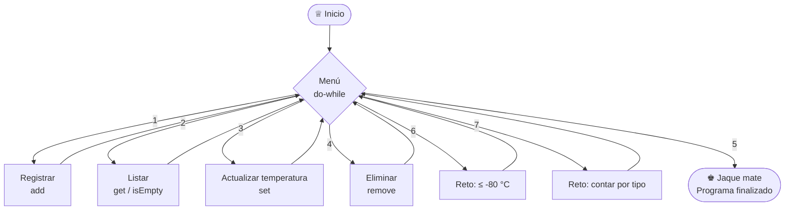

<div align="center">

```
  ╔═══╤═══╤═══╤═══╤═══╤═══╤═══╤═══╗
8 ║ ♜ │ ♞ │ ♝ │ ♛ │ ♚ │ ♝ │ ♞ │ ♜ ║
7 ║ ♟ │ ♟ │ ♟ │   │ ♟ │ ♟ │ ♟ │ ♟ ║
6 ║   │ ░ │   │ ░ │   │ ░ │   │ ░ ║
5 ║ ░ │   │ ░ │ ♟ │ ░ │   │ ░ │   ║
4 ║   │ ░ │ ♙ │ ♙ │   │ ░ │   │ ░ ║
3 ║ ░ │   │ ░ │   │ ░ │   │ ░ │   ║
2 ║ ♙ │ ♙ │   │   │ ♙ │ ♙ │ ♙ │ ♙ ║
1 ║ ♖ │ ♘ │ ♗ │ ♕ │ ♔ │ ♗ │ ♘ │ ♖ ║
  ╚═══╧═══╧═══╧═══╧═══╧═══╧═══╧═══╝
    a   b   c   d   e   f   g   h
         1. d4  d5   2. c4 !
```

# ♛ Deber de Programación ♛

## ♟ Paredes Acosta Dereck Shair ♟

### *「 El Gambito del ArrayList 」*

> *"Para ganar la posición se entrega un peón.*
> *Para dominar Java se entrega cada línea de código."*

<br>


**Universidad Técnica de Ambato** · Carrera de Software · Facultad de Ingeniería en Sistemas, Electrónica e Industrial

</div>

---

## ♔ Índice de la partida

| Jugada | Pieza | Ejercicio | Nivel | Movimiento clave |
|:---:|:---:|---|:---:|---|
| `1. d4` | ♙ Peón | [Registro de calificaciones](#-1-d4--registro-de-calificaciones) | ⬜ Básico | `add` · `get` · `size` · `for-each` |
| `1... d5` | ♟ Peón | [Eliminación de duplicados](#-1-d5--eliminación-de-duplicados) | ⬜ Básico | `contains` · `indexOf` · `remove(i)` |
| `2. c4!` | ♘ Caballo | [Lista de objetos Estudiante](#-2-c4--lista-de-objetos-estudiante) | 🟫 Intermedio | Encapsulamiento · búsqueda secuencial |
| `2... e6` | ♖ Torre | [Inventario de reactivos](#-2-e6--inventario-de-reactivos-de-laboratorio) | 🟫 Intermedio | `sort` · `Comparator` · filtrado |
| `3. Nc3` | ♕ Dama | [Muestras biológicas](#-3-nc3--menú-de-gestión-de-muestras-biológicas) | ⬛ Avanzado | CRUD · `do-while` · `switch` |

```
Progreso de la partida
♙♙♙♙♙♙♙♙♙♙♙♙♙♙♙♙♙♙♙♙  100%   ✔ 5 de 5 jugadas completadas
```

---

## ♖ Estructura del tablero

```
📦 deber-programacion
 ┣ ♙ Ejercicio1.java   → Registro de calificaciones
 ┣ ♟ Ejercicio2.java   → Eliminación de duplicados
 ┣ ♘ Ejercicio3.java   → Clase Estudiante + principal
 ┣ ♖ Ejercicio4.java   → Clase Reactivo + inventario
 ┣ ♕ Ejercicio5.java   → Clase Muestra + menú CRUD
 ┗ 📜 README.md        → Estás aquí
```

> 💡 Las clases `Estudiante`, `Reactivo` y `Muestra` viven dentro del archivo de su ejercicio, así que cada partida se juega (compila) por sí sola.

---

## ♙ `1. d4` — Registro de calificaciones

<table>
<tr>
<td width="70%">

**El primer peón avanza al centro.** El programa pide cuántas notas tiene el estudiante y las guarda en un `ArrayList<Double>`. Si una nota cae fuera del tablero (menos de 0 o más de 10), se rechaza y se vuelve a pedir. Al final muestra todas las notas, el promedio, la máxima y la mínima.

</td>
<td width="30%" align="center">

**Nivel**<br>⬜ Básico<br><br>
**Piezas usadas**<br>`add` `get`<br>`size` `for-each`

</td>
</tr>
</table>

**♟ Jugada maestra:** la validación usa un `while` que no te deja avanzar hasta que la nota sea legal, igual que un árbitro que no acepta un movimiento ilegal.

```java
while (nota < 0 || nota > 10) {
    System.out.print("Nota fuera de rango. Ingrese de nuevo: ");
    nota = sc.nextDouble();
}
notas.add(nota);
```

<details>
<summary>🎬 <b>Ver la partida completa (ejecución)</b></summary>

```
¿Cuántas notas desea ingresar? 4
Nota 1: 8.5
Nota 2: 11
Nota fuera de rango. Ingrese de nuevo: 7
Nota 3: 9.25
Nota 4: 6
Notas: [8.5, 7.0, 9.25, 6.0]
Promedio: 7.69
Máxima: 9.25 | Mínima: 6.0
```
</details>

---

## ♟ `1... d5` — Eliminación de duplicados

<table>
<tr>
<td width="70%">

**Las negras responden simétricamente.** El método `sinDuplicados(ArrayList<Integer> lista)` construye una lista **nueva** sin repeticiones y respeta el orden de la primera aparición. La lista original queda intacta, y además se informa cuántos elementos repetidos salieron del tablero.

</td>
<td width="30%" align="center">

**Nivel**<br>⬜ Básico<br><br>
**Piezas usadas**<br>`contains`<br>método `static`

</td>
</tr>
</table>

```
Original:        [4, 7, 4, 2, 9, 7, 7, 1]
                     ✘           ✘  ✘      ← capturadas
Sin duplicados:  [4, 7, 2, 9, 1]
Elementos eliminados: 3
```

**♞ Reto adicional — jugar en la lista original:** borrar dentro de un `for-each` es una trampa que termina en `ConcurrentModificationException`. La solución es retroceder como una torre, recorriendo con índice **desde el final hacia el inicio**:

```java
for (int i = lista.size() - 1; i >= 0; i--) {
    if (lista.indexOf(lista.get(i)) < i) {   // ya apareció antes → duplicado
        lista.remove(i);
    }
}
```

---

## ♘ `2. c4!` — Lista de objetos Estudiante

<table>
<tr>
<td width="70%">

**¡El gambito!** Aquí la partida se vuelve interesante: ya no movemos números, sino **objetos**. La clase `Estudiante` protege sus atributos privados (`codigo`, `nombre`, `promedio`) con su constructor, sus *getters* y `toString()`. La clase principal arma la lista, busca un estudiante por código de forma secuencial, lo elimina por índice y encuentra el mejor promedio.

</td>
<td width="30%" align="center">

**Nivel**<br>🟫 Intermedio<br><br>
**Piezas usadas**<br>Encapsulamiento<br>`remove(int)`

</td>
</tr>
</table>

```
          ┌────────────────────────────┐
          │      ♘  Estudiante         │
          ├────────────────────────────┤
          │ - codigo   : String        │
          │ - nombre   : String        │
          │ - promedio : double        │
          ├────────────────────────────┤
          │ + Estudiante(c, n, p)      │
          │ + getCodigo() : String     │
          │ + getNombre() : String     │
          │ + getPromedio() : double   │
          │ + toString() : String      │
          └────────────────────────────┘
```

**♟ Jugada maestra:** la búsqueda secuencial revisa casilla por casilla y devuelve `-1` si la pieza no está en el tablero.

<details>
<summary>🎬 <b>Ver la partida completa (ejecución)</b></summary>

```
--- Lista de estudiantes ---
E001 - Ana Torres - 8.75
E002 - Luis Mena - 6.4
E003 - Carla Ruiz - 9.2
E004 - Jorge Vaca - 7.1
Encontrado E003 en la posición 2: Carla Ruiz
No existe el estudiante E009
Eliminado: E002 - Luis Mena - 6.4
--- Lista actualizada ---
E001 - Ana Torres - 8.75
E003 - Carla Ruiz - 9.2
E004 - Jorge Vaca - 7.1
Total de estudiantes: 3
Mejor promedio: Carla Ruiz (9.2)
```
</details>

---

## ♖ `2... e6` — Inventario de reactivos de laboratorio

<table>
<tr>
<td width="70%">

**La torre ordena las filas.** Cada `Reactivo` tiene `nombre`, `cantidad` y `stockMinimo` en gramos. Se registran cinco en un `ArrayList<Reactivo>`, se ordenan alfabéticamente, se consumen cantidades con `consumir()` (solo si alcanza el stock), se reordenan de mayor a menor cantidad y se filtran los que hay que reponer.

</td>
<td width="30%" align="center">

**Nivel**<br>🟫 Intermedio<br><br>
**Piezas usadas**<br>`sort`<br>`Comparator`

</td>
</tr>
</table>

**♟ Jugada maestra:** dos estrategias de ordenamiento sobre la misma lista.

```java
// Por nombre (A → Z)
inventario.sort(Comparator.comparing(Reactivo::getNombre, String.CASE_INSENSITIVE_ORDER));

// Por cantidad (mayor → menor)
inventario.sort(Comparator.comparingDouble(Reactivo::getCantidad).reversed());
```

| Reactivo | Cantidad | Stock mín. | Estado |
|---|---:|---:|:---:|
| NaCl | 250.0 g | 100.0 g | ✅ Seguro |
| Tris-HCl | 120.0 g | 50.0 g | ✅ Seguro |
| EDTA | 25.0 g | 30.0 g | ⚠️ En jaque |
| Agarosa | 15.0 g | 20.0 g | ⚠️ En jaque |
| SDS | 8.0 g | 10.0 g | ⚠️ En jaque |

<details>
<summary>🎬 <b>Ver la partida completa (ejecución)</b></summary>

```
--- Inventario por nombre ---
Agarosa: 15.0 g (mín. 20.0 g)
EDTA: 40.0 g (mín. 30.0 g)
NaCl: 250.0 g (mín. 100.0 g)
SDS: 8.0 g (mín. 10.0 g)
Tris-HCl: 120.0 g (mín. 50.0 g)
Consumo de 15 g de EDTA: true
Consumo de 30 g de SDS: false
--- Inventario por cantidad ---
NaCl: 250.0 g (mín. 100.0 g)
Tris-HCl: 120.0 g (mín. 50.0 g)
EDTA: 25.0 g (mín. 30.0 g)
Agarosa: 15.0 g (mín. 20.0 g)
SDS: 8.0 g (mín. 10.0 g)
--- Reactivos por reponer ---
EDTA: 25.0 g (mín. 30.0 g)
Agarosa: 15.0 g (mín. 20.0 g)
SDS: 8.0 g (mín. 10.0 g)
```
</details>

---

## ♕ `3. Nc3` — Menú de gestión de muestras biológicas

<table>
<tr>
<td width="70%">

**Entra la Dama: la pieza más poderosa.** Un menú interactivo administra las muestras de un biobanco. Cada `Muestra` tiene `id`, `tipo` y `temperatura` en °C. Están las cuatro operaciones CRUD completas, no se aceptan IDs repetidos y, si la lista está vacía, el programa avisa.

</td>
<td width="30%" align="center">

**Nivel**<br>⬛ Avanzado<br><br>
**Piezas usadas**<br>`add` `get` `set`<br>`remove` `isEmpty`

</td>
</tr>
</table>



| Opción | Operación | Método de ArrayList |
|:---:|---|---|
| `1` | Registrar (sin IDs repetidos) | `add()` |
| `2` | Listar todas | `get()` · `isEmpty()` |
| `3` | Actualizar temperatura | `set()` |
| `4` | Eliminar | `remove()` |
| `5` | Salir | — |
| `6` | 🏆 **Reto:** muestras a −80 °C o menos | filtrado |
| `7` | 🏆 **Reto:** cantidad por tipo | `indexOf()` · `set()` |

<details>
<summary>🎬 <b>Ver la partida completa (ejecución)</b></summary>

```
1. Registrar  2. Listar  3. Actualizar temperatura  4. Eliminar  5. Salir
Opción: 1
ID: M-01
Tipo: Sangre
Temperatura (°C): -20
Muestra registrada.
Opción: 1
ID: M-01
Ya existe una muestra con ese ID.
Opción: 3
ID: M-01
Nueva temperatura (°C): -80
Temperatura actualizada.
Opción: 2
[0] M-01 | Sangre | -80.0 °C
Opción: 5
Programa finalizado.
```
</details>

---

## ♗ Cómo jugar (compilar y ejecutar)

```bash
# Clonar el tablero
git clone https://github.com/dereckflux/<nombre-del-repositorio>.git
cd <nombre-del-repositorio>

# Elegir una partida y jugarla
javac Ejercicio1.java
java Ejercicio1
```

> ♟ Cambia `Ejercicio1` por `Ejercicio2` … `Ejercicio5` para jugar las demás partidas.
> **Requisito:** JDK 8 o superior.

---

## ♔ Notación de la partida

```
 ┌──────────────────────────────────────────────────────────┐
 │  1. d4    d5        ♙ add / get / size  ·  ♟ contains     │
 │  2. c4!   e6        ♘ objetos           ·  ♖ Comparator   │
 │  3. Nc3   ...       ♕ CRUD completo                       │
 │                                                          │
 │  Resultado: 1 — 0   ✔ Todos los ejercicios superados      │
 └──────────────────────────────────────────────────────────┘
```

---

<div align="center">

### ♚ Jaque mate ♚

*"Cada `ArrayList` es un tablero: lo que importa es saber mover las piezas."*

**Paredes Acosta Dereck Shair**
[](https://github.com/dereckflux)

`♜ ♞ ♝ ♛ ♚ ♝ ♞ ♜`

</div>
