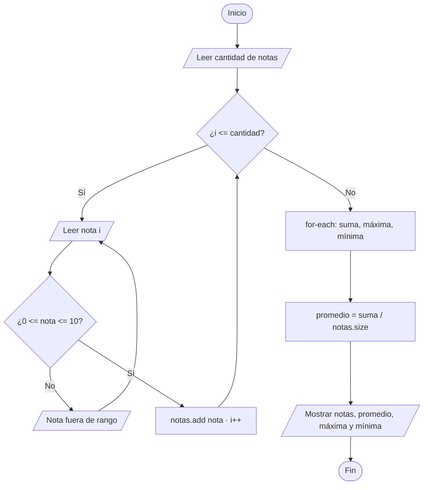
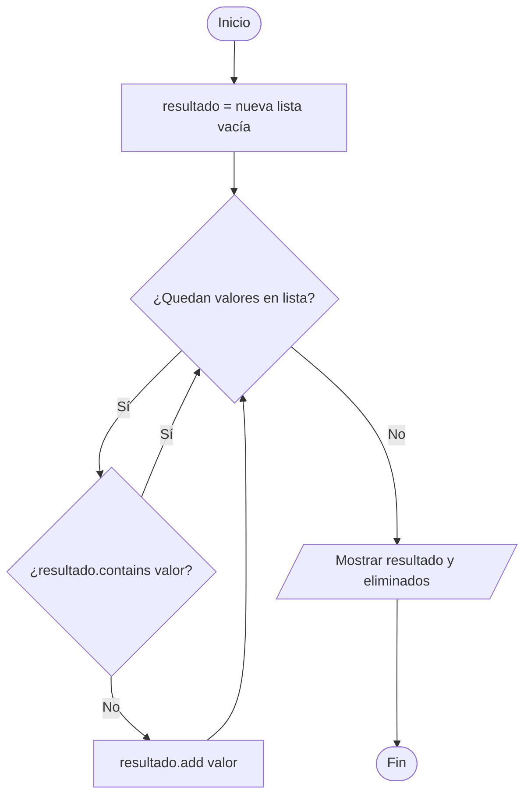
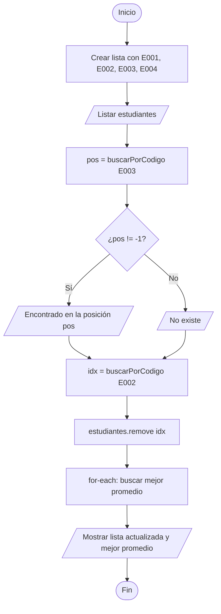
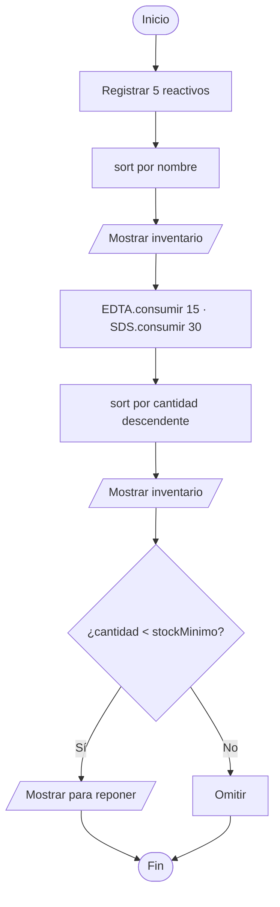
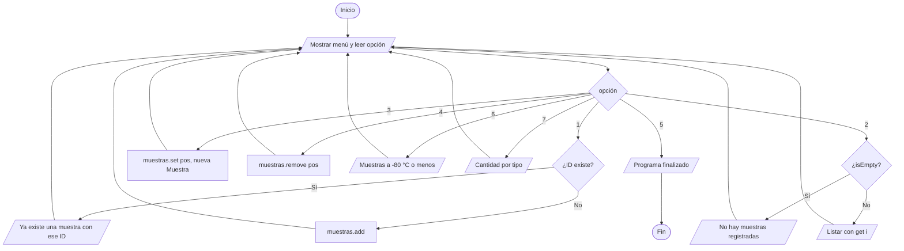

<a name="inicio"></a>

<div align="center">


# ♛ PAREDES ACOSTA DERECK SHAIR ♛

### ♟️ Deber de Programación · Ejercicios sobre `ArrayList` en Java

*Cinco jugadas, una sola apertura: el Gambito de Dama*


</div>

<p align="center">
  <strong>♔ EL CLUB DE AJEDREZ · FACULTAD DE INGENIERÍA EN SISTEMAS, ELECTRÓNICA E INDUSTRIAL</strong><br>
  <em>«Se entrega un peón para ganar el centro. Se entrega cada línea de código para ganar la partida.»</em>
</p>

<div align="center">


<br>


<br><br>

**Bienvenido al torneo: las piezas ya están en sus casillas.**<br>
Este repositorio reúne los **5 ejercicios** del deber sobre `ArrayList`, cada uno como una jugada de la misma apertura: **Registro de calificaciones**, **Eliminación de duplicados**, **Lista de estudiantes**, **Inventario de reactivos** y **Muestras biológicas**.<br>
Cada partida incluye enunciado, análisis, diagrama de flujo, prueba de escritorio y codificación en **Java**.

**Un jugador. Cinco partidas. Una apertura. Cero errores de compilación.**

[♔ Expediente](#expediente) ·
[♚ Jugador](#jugador) ·
[📋 Planilla](#planilla) ·
[♙ Partida 1](#partida-1) ·
[♟ Partida 2](#partida-2) ·
[♘ Partida 3](#partida-3) ·
[♖ Partida 4](#partida-4) ·
[♕ Partida 5](#partida-5) ·
[▶️ Cómo jugar](#como-jugar) ·
[🏆 Jaque mate](#jaque-mate)

</div>

---

<a name="expediente"></a>

## ♔ El expediente · ¿De qué trata este repositorio?

Como en el **Gambito de Dama**, se cede algo al principio para dominar el centro del tablero. Aquí lo que está en el centro es el `ArrayList`: las cinco partidas son distintas, pero todas giran alrededor de **agregar, recorrer, buscar, ordenar, reemplazar y eliminar** elementos de una lista dinámica.

<div align="center">

</div>

### 🎯 Objetivos del torneo

- **Dominar el centro**: usar `add`, `get`, `size`, `set`, `remove`, `contains`, `indexOf` e `isEmpty`.
- **Recorrer el tablero**: `for-each` para leer y `for` con índice cuando hay que modificar.
- **Mover piezas con identidad**: listas de objetos (`Estudiante`, `Reactivo`, `Muestra`) con atributos privados.
- **Ordenar las filas**: `sort` con `Comparator` por nombre y por cantidad.
- **No aceptar jugadas ilegales**: validar rangos, IDs repetidos, stock insuficiente y listas vacías.

> [!TIP]
> **Lema del club:** «Una jugada ilegal no se discute: se rechaza y se vuelve a mover».

---

<a name="jugador"></a>

## ♚ El jugador · Integrante y rol

Este torneo se jugó en solitario. Un solo jugador frente al tablero:

<div align="center">

</div>

| N.º | Integrante | Rol en el tablero | Componentes |
| :---: | :--- | :--- | :--- |
| **1** | **PAREDES ACOSTA DERECK SHAIR** | **Gran Maestro del Código · Analizar, planear, mover y verificar** | Los 5 ejercicios completos en **Java**, con sus pruebas de escritorio. |

| Dato | Detalle |
| :--- | :--- |
| **Carrera** | Software |
| **Nivel y paralelo** | Primero - B |
| **Universidad** | Universidad Técnica de Ambato |
| **Tema** | Colecciones dinámicas: `ArrayList` en Java |

---

<a name="planilla"></a>

## 📋 La planilla · Las 5 partidas

| Jugada | Pieza | Ejercicio | Archivo | Nivel | Lo que se practica |
| :---: | :---: | :--- | :--- | :---: | :--- |
| `1. d4` | ♙ | **Registro de calificaciones** | `Ejercicio1.java` | Básico | `add`, `get`, `size`, `for-each` y validación de rango |
| `1... d5` | ♟ | **Eliminación de duplicados** | `Ejercicio2.java` | Básico | `contains`, lista nueva, método `static` y reto en la lista original |
| `2. c4!` | ♘ | **Lista de objetos Estudiante** | `Ejercicio3.java` | Intermedio | Encapsulamiento, búsqueda secuencial y `remove` por índice |
| `2... e6` | ♖ | **Inventario de reactivos** | `Ejercicio4.java` | Intermedio | `sort` con `Comparator`, modificar objetos y filtrar |
| `3. Nc3` | ♕ | **Muestras biológicas** | `Ejercicio5.java` | Avanzado | CRUD completo, `isEmpty`, menú `do-while` + `switch` |

---

<a name="partida-1"></a>

## ♙ Partida 1 · `1. d4` · Registro de calificaciones

**El enunciado.** Solicitar la cantidad de calificaciones de un estudiante y almacenarlas en un `ArrayList<Double>`. Las notas deben estar entre **0 y 10**; si se ingresa un valor fuera de ese rango, se vuelve a pedir. Al final se muestran todas las notas, el **promedio**, la **nota máxima** y la **nota mínima**.

| Fase | Datos |
| :--- | :--- |
| **⬛ Entrada** | `cantidad` (mayor que 0) y cada `nota` (0 a 10). |
| **🟫 Proceso** | Validar con `while`, guardar con `add`, recorrer con `for-each` acumulando suma, máxima y mínima. |
| **⬜ Salida** | Lista de notas, promedio con dos decimales, máxima y mínima. |



**Prueba de escritorio**

| i | Valor ingresado | ¿Válida? | `notas` | | `n` | `suma` | `maxima` | `minima` |
| :---: | :---: | :---: | :--- | :---: | :---: | :---: | :---: | :---: |
| 1 | 8.5 | ✅ | `[8.5]` | | 8.5 | 8.5 | 8.5 | 8.5 |
| 2 | 11 | ❌ | `[8.5]` | | 7.0 | 15.5 | 8.5 | 7.0 |
| 2 | 7 | ✅ | `[8.5, 7.0]` | | 9.25 | 24.75 | 9.25 | 7.0 |
| 3 | 9.25 | ✅ | `[8.5, 7.0, 9.25]` | | 6.0 | 30.75 | 9.25 | **6.0** |
| 4 | 6 | ✅ | `[8.5, 7.0, 9.25, 6.0]` | | — | — | — | — |

`promedio = 30.75 / 4 = 7.6875 → 7.69`

```text
¿Cuántas notas desea ingresar? 4
Nota 1: 8.5
Nota 2: 11
Nota fuera de rango. Ingrese de nuevo: 7
Nota 3: 9.25
Nota 4: 6
Notas: [8.5, 7.0, 9.25, 6.0]
Promedio: 7.69
Máxima: 9.25 | Mínima: 6.0
```

> [!NOTE]
> El `Scanner` usa `Locale.US` para que los decimales se escriban con **punto** (`8.5`) sin importar la configuración regional del equipo.

---

<a name="partida-2"></a>

## ♟ Partida 2 · `1... d5` · Eliminación de duplicados

**El enunciado.** Implementar `public static ArrayList<Integer> sinDuplicados(ArrayList<Integer> lista)`, que devuelva una **nueva** lista sin repeticiones, conservando el orden de la primera aparición, **sin modificar** la original, y mostrar cuántos repetidos se eliminaron.

| Fase | Datos |
| :--- | :--- |
| **⬛ Entrada** | Lista original `[4, 7, 4, 2, 9, 7, 7, 1]`. |
| **🟫 Proceso** | Recorrer la original y agregar a `resultado` solo si `!resultado.contains(valor)`. |
| **⬜ Salida** | Lista original, lista sin duplicados y cantidad eliminada (`8 − 5 = 3`). |



**Prueba de escritorio**

| Valor | `contains` | Acción | `resultado` |
| :---: | :---: | :--- | :--- |
| 4 | false | `add` | `[4]` |
| 7 | false | `add` | `[4, 7]` |
| 4 | true | ✘ capturado | `[4, 7]` |
| 2 | false | `add` | `[4, 7, 2]` |
| 9 | false | `add` | `[4, 7, 2, 9]` |
| 7 | true | ✘ capturado | `[4, 7, 2, 9]` |
| 7 | true | ✘ capturado | `[4, 7, 2, 9]` |
| 1 | false | `add` | `[4, 7, 2, 9, 1]` |

### ♞ Reto adicional · Jugar sobre la lista original

Borrar dentro de un `for-each` provoca `ConcurrentModificationException`. La solución es recorrer **de atrás hacia adelante** con un `for` con índice, como una torre que retrocede:

```java
for (int i = lista.size() - 1; i >= 0; i--) {
    if (lista.indexOf(lista.get(i)) < i) {   // ya apareció antes → duplicado
        lista.remove(i);
    }
}
```

| i | `get(i)` | `indexOf` | ¿Se elimina? | Lista |
| :---: | :---: | :---: | :---: | :--- |
| 7 | 1 | 7 | No | `[4, 7, 4, 2, 9, 7, 7, 1]` |
| 6 | 7 | 1 | ✅ | `[4, 7, 4, 2, 9, 7, 1]` |
| 5 | 7 | 1 | ✅ | `[4, 7, 4, 2, 9, 1]` |
| 4 | 9 | 4 | No | `[4, 7, 4, 2, 9, 1]` |
| 3 | 2 | 3 | No | `[4, 7, 4, 2, 9, 1]` |
| 2 | 4 | 0 | ✅ | `[4, 7, 2, 9, 1]` |
| 1 | 7 | 1 | No | `[4, 7, 2, 9, 1]` |
| 0 | 4 | 0 | No | **`[4, 7, 2, 9, 1]`** |

```text
Original: [4, 7, 4, 2, 9, 7, 7, 1]
Sin duplicados: [4, 7, 2, 9, 1]
Elementos eliminados: 3
```

---

<a name="partida-3"></a>

## ♘ Partida 3 · `2. c4!` · Lista de objetos Estudiante

**El enunciado.** Crear la clase `Estudiante` con los atributos privados `codigo` (String), `nombre` (String) y `promedio` (double), su constructor, sus *getters* y `toString()`. En la clase principal se almacenan los estudiantes en un `ArrayList`, se busca por código de forma **secuencial**, se elimina por **índice** y se obtiene el **mejor promedio**.

### ♘ La clase `Estudiante`

| Atributo | Tipo | Acceso |
| :--- | :---: | :--- |
| `codigo` | `String` | `private` · `getCodigo()` |
| `nombre` | `String` | `private` · `getNombre()` |
| `promedio` | `double` | `private` · `getPromedio()` |



**Prueba de escritorio**

| Búsqueda | i | `get(i).getCodigo()` | ¿`equals`? | Retorno |
| :---: | :---: | :---: | :---: | :---: |
| `E003` | 0 → 1 → 2 | E001 → E002 → **E003** | No → No → ✅ | **2** |
| `E009` | 0 → 3 | E001 … E004 | Ninguno | **−1** |
| `E002` | 0 → 1 | E001 → **E002** | No → ✅ | **1** → `remove(1)` |

| `e` | `promedio` | ¿Mayor que `mejor`? | `mejor` |
| :---: | :---: | :---: | :---: |
| E001 | 8.75 | No | E001 |
| E003 | 9.2 | ✅ | **E003** |
| E004 | 7.1 | No | E003 |

```text
Encontrado E003 en la posición 2: Carla Ruiz
No existe el estudiante E009
Eliminado: E002 - Luis Mena - 6.4
Total de estudiantes: 3
Mejor promedio: Carla Ruiz (9.2)
```

> [!NOTE]
> Al hacer `remove(1)`, las piezas de la derecha se recorren una casilla a la izquierda: **E003** pasa al índice 1 y **E004** al índice 2.

---

<a name="partida-4"></a>

## ♖ Partida 4 · `2... e6` · Inventario de reactivos de laboratorio

**El enunciado.** Crear la clase `Reactivo` con `nombre`, `cantidad` y `stockMinimo` (en gramos). Registrar cinco reactivos en un `ArrayList<Reactivo>`, mostrarlos **ordenados alfabéticamente**, registrar consumos con `consumir()` (solo si hay existencias), mostrarlos **ordenados por cantidad de mayor a menor** y listar los que están **por debajo del stock mínimo**.

| Método | Qué hace |
| :--- | :--- |
| `consumir(gramos)` | Si `gramos <= cantidad`, descuenta y devuelve `true`; si no, devuelve `false` |
| `necesitaReposicion()` | Devuelve `true` si `cantidad < stockMinimo` |
| `toString()` | `Nombre: cantidad g (mín. stock g)` |

```java
inventario.sort(Comparator.comparing(Reactivo::getNombre, String.CASE_INSENSITIVE_ORDER)); // A → Z
inventario.sort(Comparator.comparingDouble(Reactivo::getCantidad).reversed());            // mayor → menor
```



**Prueba de escritorio**

| Reactivo | Cantidad inicial | Consumo | ¿Hay stock? | Cantidad final | Stock mín. | Estado |
| :--- | :---: | :---: | :---: | :---: | :---: | :---: |
| NaCl | 250.0 g | — | — | 250.0 g | 100.0 g | ✅ Seguro |
| Tris-HCl | 120.0 g | — | — | 120.0 g | 50.0 g | ✅ Seguro |
| EDTA | 40.0 g | 15 g | ✅ `true` | 25.0 g | 30.0 g | ⚠️ En jaque |
| Agarosa | 15.0 g | — | — | 15.0 g | 20.0 g | ⚠️ En jaque |
| SDS | 8.0 g | 30 g | ❌ `false` | 8.0 g | 10.0 g | ⚠️ En jaque |

```text
--- Inventario por cantidad ---
NaCl: 250.0 g (mín. 100.0 g)
Tris-HCl: 120.0 g (mín. 50.0 g)
EDTA: 25.0 g (mín. 30.0 g)
Agarosa: 15.0 g (mín. 20.0 g)
SDS: 8.0 g (mín. 10.0 g)
--- Reactivos por reponer ---
EDTA: 25.0 g (mín. 30.0 g)
Agarosa: 15.0 g (mín. 20.0 g)
SDS: 8.0 g (mín. 10.0 g)
```

---

<a name="partida-5"></a>

## ♕ Partida 5 · `3. Nc3` · Menú de gestión de muestras biológicas

**El enunciado.** Administrar las muestras de un biobanco con un menú interactivo. Cada `Muestra` tiene `id`, `tipo` y `temperatura` (°C). El menú permite **registrar** sin IDs repetidos, **listar**, **actualizar la temperatura** reemplazando con `set`, **eliminar** y **salir**. Si la lista está vacía al listar, se informa al usuario.

### 🎛️ El menú

| Opción | Operación | Método | Regla |
| :---: | :--- | :--- | :--- |
| **1** | Registrar | `add()` | El ID no puede repetirse |
| **2** | Listar | `get()` · `isEmpty()` | Avisa si no hay muestras |
| **3** | Actualizar temperatura | `set()` | Reemplaza el objeto en su misma posición |
| **4** | Eliminar | `remove()` | El ID debe existir |
| **5** | Salir | — | «Programa finalizado.» |
| **6** | 🏆 Reto: ultracongeladas | filtrado | Temperatura ≤ −80 °C |
| **7** | 🏆 Reto: contar por tipo | `indexOf()` · `set()` | Listas paralelas de tipos y conteos |



**Prueba de escritorio**

| Paso | Opción | Entradas | `buscar(id)` | Operación | Lista resultante | Resultado |
| :---: | :---: | :--- | :---: | :--- | :--- | :--- |
| **1** | 2 | — | — | `isEmpty() = true` | `[]` | ✅ «No hay muestras registradas.» |
| **2** | 1 | M-01, Sangre, −20 | −1 | `add` | `[M-01 · Sangre · −20.0]` | ✅ Muestra registrada |
| **3** | 1 | M-01 | 0 | — | Sin cambios | ⚠️ ID repetido |
| **4** | 3 | M-01, −80 | 0 | `set(0, …)` | `[M-01 · Sangre · −80.0]` | ✅ Temperatura actualizada |
| **5** | 1 | M-02, ADN, −20 | −1 | `add` | `[M-01 …, M-02 · ADN · −20.0]` | ✅ Muestra registrada |
| **6** | 6 | — | — | filtrar ≤ −80 | Sin cambios | ✅ Muestra solo M-01 |
| **7** | 7 | — | — | conteo | Sin cambios | ✅ Sangre: 1 · ADN: 1 |
| **8** | 4 | M-02 | 1 | `remove(1)` | `[M-01 · Sangre · −80.0]` | ✅ Muestra eliminada |
| **9** | 5 | — | — | — | — | ♚ Programa finalizado |

```text
1. Registrar  2. Listar  3. Actualizar temperatura  4. Eliminar  5. Salir
Opción: 1
ID: M-01
Tipo: Sangre
Temperatura (°C): -20
Muestra registrada.
Opción: 3
ID: M-01
Nueva temperatura (°C): -80
Temperatura actualizada.
Opción: 2
[0] M-01 | Sangre | -80.0 °C
Opción: 5
Programa finalizado.
```

---

## 🗂️ El tablero · Estructura del repositorio

```text
deber-programacion/
┣ ♙ Ejercicio1.java   → Registro de calificaciones
┣ ♟ Ejercicio2.java   → Eliminación de duplicados
┣ ♘ Ejercicio3.java   → Clase Estudiante + principal
┣ ♖ Ejercicio4.java   → Clase Reactivo + inventario
┣ ♕ Ejercicio5.java   → Clase Muestra + menú CRUD
┗ 📜 README.md
```

---

<a name="como-jugar"></a>

## ▶️ Cómo jugar · Mueve la primera pieza

Cada partida se compila y ejecuta por separado. Por ejemplo, para la Partida 5:

**☕ Java**

```bash
javac Ejercicio5.java
java Ejercicio5
```

| Partida | Compilar | Ejecutar |
| :---: | :--- | :--- |
| **♙ 1** | `javac Ejercicio1.java` | `java Ejercicio1` |
| **♟ 2** | `javac Ejercicio2.java` | `java Ejercicio2` |
| **♘ 3** | `javac Ejercicio3.java` | `java Ejercicio3` |
| **♖ 4** | `javac Ejercicio4.java` | `java Ejercicio4` |
| **♕ 5** | `javac Ejercicio5.java` | `java Ejercicio5` |

> [!IMPORTANT]
> - Cada archivo se llama igual que su clase pública (`Ejercicio1` … `Ejercicio5`).
> - Las clases `Estudiante`, `Reactivo` y `Muestra` están dentro del archivo de su ejercicio (sin `public`), por eso cada partida compila sola.
> - Se necesita **JDK 8 o superior**.

---

<a name="jaque-mate"></a>

## 🏆 Jaque mate · Se guardan las piezas

<div align="center">


```text
 1. d4  d5   2. c4!  e6   3. Nc3  ...        Resultado: 1 – 0  ♚
```

*«Se termina la partida. Las piezas vuelven a la caja, pero el `ArrayList` sigue en el centro del tablero.»*

Si llegaste hasta aquí, gracias por quedarte hasta el jaque mate. ♛♜♝♞♟

[⬆️ Volver al inicio](#inicio)


</div>
